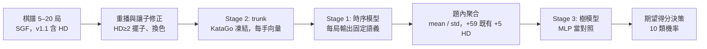

# 三階段架構設計草案：時序提取 → 空間特徵 → 樹模型

AI CUP 2026 圍棋等級預測（競賽二）· 2026-11-02 · BK · 討論稿，尚未事先指定、尚未開工。第 12 節是 2026-11-02 與 GPT 第一輪討論後的修訂，第 13 節是用本地資料對 GPT 意見的逐條核對。

## 0. 這份文件要討論什麼

提案是一條三階段管線：時序模型把每局的細粒度時序特徵全部抓出來（類比 nnU-Net 保留細節）、CNN 抓更高階的特徵（類比 KataGo）、樹模型做最後分類並在訓練中剔除沒用的訊號。前兩階段要「最大化」提取。這份文件把提案寫成可檢驗的設計、附上現有證據、列出必要的對照，最後是要和 GPT 討論的問題。

提案者對過去失敗的診斷有兩點：樹模型輸給 MLP 是因為餵進去的特徵訊號不夠；而且過去只有一層特徵處理（每手分數加總再做題目統計），沒有多層提取。本文把這兩點當成要檢驗的假設，不是前提。

本文立場：骨架可行、值得測。現有證據指出主要風險不是「沒用的訊號」，而是「玩家指紋」，也就是在訓練玩家身上能預測等級、到新玩家就失效的特徵。設計的每一層都要內建對指紋的防護與檢測，否則會重演 2026-11-01 三組特徵實驗的退步（第 4 節）。

## 1. 任務與資料

任務：給一位玩家的 5–20 局棋譜（SGF，含雙方著手與目標執色），預測等級，10 級弱到強：D、C、B、A、1D–6D。官方評分：命中 1、差一級 e^-1 ≈ 0.368、其餘 0；我們內部按 n = 5、10、20 局平衡平均。測試 Public 400 題 + Private 400 題，11/04 釋出，11/24 截止，每日上傳 5 次，最後一次算成績。

訓練資料：1,000,000 局、8,007 位玩家，每級 100,000 局；每位玩家只屬一個等級；每局只有一方是標籤玩家，對手等級未知；100 萬局棋譜全部唯一，對手不在資料集中。沒有勝負（RE）、貼目、玩家名、時間。每局中位數 228 手。

資料集 v1.1（2026-10-31）在每局 SGF 加了 HD[n] 讓子資訊，其餘與 v1.0 逐字相同（100 萬局驗證過）：

| HD | 意思 | 占比 | 棋盤與標記 |
| --- | --- | --- | --- |
| 0 | 互先，貼目 6.5 | 79.3% | 如記錄 |
| 1 | 讓先，不貼目 | 17.1% | 如記錄，黑是下手 |
| 2–9 | 讓 n 子，不貼目 | 3.6%（36,421 局，3,474 位玩家） | 讓子石未記錄（按標準星位補）；著手 B/W 標記相反；`color` 欄是實際顏色，W 為上手 |

`color` 的語義由資料驗證：HD ≥ 2 時標 W 的玩家平均等級索引 6.41，標 B 的 5.60；HD = 9 時 6.43 對 0.99。讓子分布呈 U 形：D 級 35% 的局有讓子，6D 執白時 30% 在讓人。影響：現行評分對那 3.6% 的局是在缺子棋盤上、而且把對手的棋當成目標在評；修正的重播程式已寫完，重評分尚未執行。HD 本身是伺服器依雙方等級差設的，是標籤側資訊。

## 2. 現行管線與成績

現行提交候選 `fused_opp_diff`：CV 0.6916，fold 0 單次檢查 0.6888；官方 baseline Public 0.4631；Public LB 尚未上傳。標籤側資訊（對手）是近期唯一有效的增益來源。

管線五步：

1. 重播：KataGo 的 Board/GameState 逐手重播（讓子修正接在這裡）。
2. 每手評分（GPU）：KataGo Human SL `b18c384nbt-humanv0`，以 18 個等級 profile（12k 到 6d）各前向一次，取實際落子的 log p，每手 18 維。L1b：凍結 trunk + 10 個等級各一個 policy head（自訓），每手 10 維；對手的著手也用同一組 head 評，每手 10 維。Head 按玩家分組 cross-fit：A 用 folds 1、2 訓、評 0、3、4；B 用 3、4 訓、評 0、1、2。只存實際落子那一格的 log p，不存 362 維分布、value、trunk 向量。
3. 每局：各維度對手數加總（sum_<profile>）。
4. 每題：題內各局加總的統計量：hsl 24 + l1b 16 + opp 16 = 56 維；再加 3 維對手差值（每局 pmi = 10 個 L1b 加總的 softmax 期望等級；題內 mean(opp − own)、mean(opp)、std(opp)）= 59 維。
5. 題目層模型：MLP（1 層 ReLU、hidden 32、full-batch Adam fp64、300 epoch、l2 1e-4、類別平衡權重），輸入標準化；A、B 兩組特徵各預測後平均機率；期望得分決策。

| 特徵集 | 維度 | CV folds 1–4 | fold 0 |
| --- | --- | --- | --- |
| hsl | 24 | — | 0.6113 |
| fused（hsl + l1b） | 40 | 0.6545 | 0.6535 |
| fused_opp（+ 對手 16） | 56 | 0.6735 | 0.6716 |
| fused_opp_diff（+ 差值 3） | 59 | 0.6916 | 0.6888 |

從 hsl 到 fused_opp_diff 的 +0.08 裡，L1b 自訓 head 約 +0.04，對手通道兩步共約 +0.036。

## 3. 評估協定（所有實驗共用）

每一條新特徵或新模型都用同一套協定比，比較在看到結果前寫在 GitHub issue 上。

- 折：按玩家分組 5 折。fold 0 只做採用前的單次檢查（已用在 fused、fused_opp、fused_opp_diff），不再用它選任何東西。CV 在 folds 1–4 留一折。
- 驗證題：每人 1 題 20 局 + 2 題 10 局 + 4 題 5 局（巢狀切自該人的局），每折約 9,800 題、約 1,590 人。訓練題：其餘三折每人 32 題，局數 5–20 隨機，約 152,000 題。
- 比較：同一批題的配對差，玩家 bootstrap 5,000 次的 95% CI。事先指定的採用條件：(1) CI 下界 > 0；(3) 四折至少三折 > 0；(4) 差 ≥ 0.005。只報告的比較不作決策。
- 雜訊底線：同一特徵改動 float32 捨入就能讓單折動 ±0.001，比這小的差都不讀。
- 每局的學習式特徵（序列 encoder、後面的 Stage 1）一律四折 cross-fit：第 k 折的輸出由沒看過第 k 折玩家的模型產生。

## 4. 已有證據

三件事決定設計方向：多加特徵就退步且有劑量關係、但純雜訊不傷；樹在相同特徵上輸 MLP 兩次；單局訓練指標與題目層分數脫鉤四次。

| 實驗（皆在 folds 1–4 CV） | 基準 | 結果 | 95% CI |
| --- | --- | --- | --- |
| L1b 自訓 head（凍結 trunk） | hsl | 約 +0.04 | — |
| 對手著手 16 維 | fused | +0.0181（fold 0） | [+0.0094, +0.0266] |
| 對手 − 自己差值 3 維 | fused_opp | +0.0181 | [+0.0140, +0.0220] |
| 集合模型（Set Transformer、PMA、cross-attn、CTM）取代 MLP（2026-10-19） | 當時 MLP | +0.005 到 +0.009 | 後來被 L1b 路線取代 |
| 每局形狀統計 8 維 | fused_opp | −0.0029 | [−0.0064, +0.0004] |
| 每手 pmi 直方圖 10 維 | fused_opp_diff | −0.0055 | [−0.0085, −0.0025] |
| TSFEL 274 維 → PCA 4 / 16 / 64 / 全 | fused_opp_diff | −0.0014 / −0.0128 / −0.0375 / −0.0610 | 16 維：[−0.0167, −0.0090] |
| 純雜訊 16 維（對照） | fused_opp_diff | −0.0014 | [−0.0042, +0.0012] |
| 序列 encoder 修正加總：conv / GRU / CTM / Transformer / Mamba / Mamba-3 | fused_opp 0.6735 | 0.6719 / 0.6732 / 0.6705 / 0.6737 / 0.6731 / 0.6724 | 全在雜訊內 |
| xgboost 代 MLP（56 維） | mlp 0.6735 | 0.6677（−0.0058） | [−0.0095, −0.0019] |
| xgboost 代 MLP（issue #6，hsl 24 / fused 40） | mlp 0.6192 / 0.6257 | 0.6179 / 0.6217 | — |
| MLP h128 / L2 ×100 / softmax / 提早停止 / 每人 64 題 / L1 1e-3 | mlp 0.6916 | −0.0050 / −0.0189 / −0.0245 / −0.0043 / −0.0007 / +0.0006 | L1：[−0.0026, +0.0038] |
| 正則化模型對 TSFEL-16 塊的抵抗 | 各自的 base | L1 −0.0033、L2 +0.0028、softmax +0.0007 | base 分數都不高於 MLP |

誤差結構（fused_opp 的 OOF 預測，39,327 題、6,354 人）：帶號誤差的變異 63.6% 在玩家之間；全對的玩家 18.4%（獨立期望 5.1%），全錯 14.1%（3.8%）；n = 5 / 10 / 20 的命中率 0.496 / 0.544 / 0.570；每手 pmi 在相鄰等級間的分布重疊係數 0.86–0.94。標籤對自己 pmi 的 Spearman 0.934，對對手 pmi 0.948；殘差對 (opp − own) −0.213，加差值特徵後 −0.130。解讀：標籤（伺服器等級）與「這幾局下出來的棋力」之間有每人固定的落差，落子通道量不到；對手與讓子是標籤側資訊。

三個推論：

1. 「多加特徵就退步」不是模型脆弱（雜訊對照幾乎不掉），是那些塊在訓練折與驗證折間分布移動：玩家指紋。（2026-11-02 更正：指紋檢查否定了這個解釋，見第 13 節；退步是特徵在少局題上的估計雜訊與共線性。）
2. 樹在相同特徵上輸 MLP，機率校準也較差（NLL 1.2003 對 1.1790）。
3. 單局 CE 從 8.7 壓到 4.6–5.6 都沒有變成題目層分數：單局指標不能當選模依據。

對提案者診斷的回應：「訊號不夠」解釋不了樹為什麼輸 MLP，因為兩者吃的是同一組特徵；但它可以解釋為何兩者都到不了 0.80。「特徵豐富後樹才有優勢」是可檢驗的假設，第 8 節把它列為必備對照。「層數不夠」成立，但每多一層學習式處理就多一次學指紋的機會，所以每層都要 cross-fit、都要過指紋檢查。

## 5. 架構總覽

階段順序和提案相反：空間特徵（Stage 2）在時序模型（Stage 1）之前，因為時序模型的輸入是每手局面的向量。

每一層按玩家 cross-fit：第 k 折的特徵只來自沒看過第 k 折玩家的模型。

每局 g（約 230 手）經重播後，每手得到 trunk 向量與 18 + 10 + 10 個 log p；Stage 1 把這條序列壓成每局的固定語義輸出（第 12 節：10 類等級 logits 或命名統計量，不是 64 維隱藏向量），與既有的加總一起在題內聚合；每題特徵 = 59 既有 + 5 HD + 新特徵 + 不確定度；Stage 3 出 10 類機率，仍用期望得分決策。

巢狀 cross-fit 是這張圖最容易被省掉的部分：Stage 3 的訓練特徵也必須是 out-of-fold 的，否則它學到的是「在訓練局上比較準」的特徵，到驗證折會縮水。做法是在三個訓練折內部再做一次 cross-fit，或接受已知的偏差並在報告裡註明。現行的 seq_crossfit 做法有一層輕微滲漏：第 j 折的 encoder 看過驗證折 v 的玩家，再用第 j 折的特徵訓題目層模型（方向與量化見第 13 節）。

## 6. Stage 1：時序特徵提取器

成敗在監督訊號，不在架構：六個架構用每局等級 CE 訓，全部落在 0.6705–0.6737。這一階段的設計重點是改監督、限輸出維度、四折 cross-fit。

輸入（每手一列，每局約 230 列）：

| 欄位 | 維度 | 現在就有 | 備註 |
| --- | --- | --- | --- |
| Human SL 18 個 profile 的 log p（目標手） | 18 | 是 | 稽寨已存 |
| L1b 10 個 head 的 log p（目標手、對手手） | 10 + 10 | 是 | 對手手的 Human SL 欄補 0 |
| is_target、is_opponent、t / T | 3 | 是 | |
| HD、實際顏色 | 2 | 是（v1.1） | 每局常數 |
| policy 分布摘要：熵、實際手名次、top-1 / top-5 吻合、與最佳手的機率差 | 約 5 × 18 | 否，要重評分 | 362 維向量算了但沒存 |
| KataGo 勝率與目差及每手變化（勝率損失） | 2–4 | 否，要重評分 | 落子通道唯一沒試過的形式；客觀棋損要用強網，不是 Human SL |
| trunk 向量（落子點 1 個 + 全局池化 1 個） | 384 × 2，或壓到 64 × 2 | 否，要重評分 | 第 7 節 |

架構：1-D U-Net（3 層下採樣、skip）或多尺度 dilated TCN（dilation 1、2、4、8、16，感受野約 60 手），輸出每手 d = 32 的 feature map。「保留細粒度」的做法是多尺度加分段池化，不是把每手輸出直接往下送。

池化成每局向量 h_g：三段（1–40、41–100、101 手以後）× {mean、std、q10、q90}，加全局 mean / max，約 450 維，再經線性瓶頸壓到 ≤ 64 維。維度上限是硬約束，TSFEL 的劑量曲線（+16 → −0.013、+64 → −0.038）就是理由。（2026-11-02 修訂：各折獨立訓的 encoder 隱藏向量基底不同，不能拼成同一張表；輸出改為固定語義，見第 12 節。）

監督，四個選項。2026-11-02 改為：整題監督為主（第 12 節），(a) 為輔，(d) 不進最小版：

1. (a) 自監督重建：遮蔽 15% 的手，預測被遮手的 28 維 log p（MSE）。不用等級標籤，學的是「這類棋手在這種局面會下出什麼分布」。
2. (b) 標籤側多任務：預測讓子的帶號等級差（HD ≥ 1 的局，約 20%）；預測對手側 pmi（所有局）。（2026-11-02：HD 與對手 log p 已是輸入，再預測它們會變成複製輸入，不用。）
3. (c) 等級 CE：權重 0.1，或完全不用。這是學指紋的主要途徑。
4. (d) 對抗玩家辨識：一個玩家 ID 分類頭接 gradient reversal，懲罰 h_g 中能辨識訓練玩家的成分。直接針對指紋，但有目標衝突：等級是玩家的函數，I(h;Y) ≤ I(h;P)，消掉玩家資訊會連等級資訊一起消掉。若要試，改成同等級內的玩家辨識對抗，且必與無對抗版比較。

訓練：內層驗證按玩家切（每級 10% 的玩家）；每折訓練約 88,500 局；四折各訓一個模型，第 k 折的特徵由沒看過第 k 折的模型產生。成本：現有 28 維輸入時每折 1 張 GPU 3–45 分（GRU 2–3 分、Mamba-3 23 分、Mamba 40 分）；加 trunk 向量後由 I/O 主導。

## 7. Stage 2：空間特徵（KataGo trunk）

不從頭訓 CNN，也不微調 trunk；用凍結的 KataGo trunk 取每手向量。理由：KataGo 的 trunk 由幾億個局面的密集監督（policy 362 類、勝率、領地、目差）訓成，我們的監督是 8,007 位玩家的 10 類標籤，每局 230 手共用一個。在這種監督下訓空間模型，最便宜的捷徑是認出玩家。L1b（凍結 trunk + 小 head + cross-fit）已經證明這條路有效，是 +0.04 的來源。

做法 A（建議）：每手取 trunk 最後一層的兩個向量，落子點的 384 維和全局池化的 384 維，連同勝率、目差、policy 熵在同一次前向一起存。trunk 的輸入 metadata 要固定（metadata 在 residual blocks 前就進主幹；L1b 現行是固定的 rank-unknown metadata）。儲存：1.11 億手 × 2 × 384 × float16 ≈ 170 GB；用固定隨機投影或 PCA 壓到 64 維再存 ≈ 28 GB。nano4 的 home 配額剩 17 GB，要先解決儲存。

做法 B：微調 trunk 的最後 1–2 個 block，加對抗玩家頭，A/B cross-fit。指紋風險最大，而且要重跑全部評分；只在做法 A 有跨玩家增益後才考慮。

重評分成本（粗估，trunk 輸出的 I/O 沒實測）：全量 Human SL 評分過去估一個 8 張 H200 的節點約 9 小時；加存向量後估 1–2 節點日。最小版可以完全跳過這一階段，只用現有的 28 維 log p。

## 8. Stage 3：樹模型

樹的起點比 MLP 低 0.006，所以這一階段要同時改訓練方式，並把「特徵豐富後樹才贏」當成必備對照來測。

輸入（每題）：59 既有；5 HD（互先 / 讓先 / 讓子局比例、有號讓子數平均、HD = 1 比例）；Stage 1 的輸出在題內取 mean 與 std（≤ 128）；不確定度（題內 pmi 的 std、局數、手數統計）。

模型與訓練：LightGBM 或 XGBoost 10 類；depth 3–4、min_child_weight ≥ 50（Hessian 總和，不是題數）、subsample 0.7、colsample 0.5、learning rate 0.03；提早停止用按玩家分組的內層驗證，不是隨機切，因為同一人的 32 題共用局、高度相關；對 pmi 類特徵可考慮單調約束。前兩次的 xgboost 是 depth 4–6、300 樹、隨機切，很可能學到了玩家結構。

特徵選擇：訓練內的 gain importance 不能用來剔除指紋，因為指紋在訓練玩家身上就是有用的。改用 out-of-player permutation importance：在內層的驗證玩家上打亂一個特徵，看分數掉多少；只保留在至少三折都為正貢獻的特徵。這一步在巢狀的內層做，不碰外層驗證折。

校準：期望得分決策需要可靠的機率；樹的 NLL 比 MLP 差，在內層加 temperature 或 isotonic 校準。NLL 較差不等於校準較差，要分開量。

必備對照：

1. 樹 @豐富特徵 vs MLP h32 @豐富特徵：同一組特徵上樹有沒有贏。
2. 樹 @59 維 vs 樹 @豐富特徵：豐富特徵對樹有沒有幫助。
3. 樹 @59 維（新訓練方式）vs 樹 @56 維（舊設定 0.6677，fused_opp，沒有差值 3 維）：訓練方式本身有沒有差。

替代組合：樹只做特徵篩選，分類仍交給 MLP；或樹與 MLP 的機率平均。

## 9. 評估、對照與事先指定

主比較只有一條，其餘都是歸因與否決條件。所有數字在 folds 1–4 CV，不碰 fold 0；採用時依慣例 fold 0 評一次，需使用者同意。

- 主比較（事先指定）：樹 @豐富特徵 vs MLP @fused_opp_diff（0.6916），條件 (1)(3)(4)。
- 歸因消融（只報告）：MLP @豐富 vs MLP @59；樹 @59 vs MLP @59；各拿掉 Stage 1、HD、trunk 一次。
- 純雜訊對照：每個模型加 16 欄標準常態雜訊，掉多少。

指紋檢查（事先指定為否決條件）：每折兩組驗證題。(A) 新玩家，就是標準的驗證折。(B) 訓練玩家的留出局：每位訓練玩家留 20% 的局，不進任何階段的訓練，用它們組同樣的 pilot 題。每個特徵塊報 (A)、(B) 兩組的增益；採用與否以 (A) 新玩家的配對增益、CI 與分折穩定性為準；(B) − (A) 只當診斷，差距大的塊要追查，不直接否決（2026-11-02 與 GPT 討論後改）。門檻要先在現行管線上量一次基線差再定，是給 GPT 的問題之一。

這個檢查比雜訊對照更對準問題：雜訊對照只能說模型不怕無關欄位，指紋檢查直接量「這塊特徵認的是人還是等級」。

## 10. 成本、時程與順序

先做不重評分的最小版，3–4 天內有答案；它有跨玩家增益才花重評分的錢。

| 版本 | 內容 | 程式 | 算力 | 時間 |
| --- | --- | --- | --- | --- |
| 最小版 | Stage 1 整題監督（第 12 節）+ 自監督為輔，28 維輸入，四折 cross-fit；Stage 3 樹 + MLP 對照；指紋檢查 | 1–2 天 | GPU 4 折 × 約 1 小時 + CPU | 3–4 天 |
| 完整版 | 加 trunk 向量、勝率、policy 摘要；重評分全量 | 3–5 天 | 1–2 節點日 + 30–170 GB 儲存 | 1.5–2 週 |

時程約束：11/04 測試釋出，11/24 截止，每日 5 次上傳。目前排在前面的三件事都有分數或正確性上的直接影響：讓子局的重播修正與重評分（3.6% 的局評錯了）、讓子特徵的 CV（標籤側資訊；2026-11-02 已通過 +0.0071）、11/04 兩版上 Public LB。三階段架構的最小版排在這三件之後；完整版只在最小版通過指紋檢查且有增益時才開。

算力環境：國網 nano4，每節點 8 張 H200，每張 GPU 配 12 核，同時最多 20 支工作；近幾天節點負載高，同一支工作的時間可差 3–7 倍。

## 11. 給 GPT 的問題

前三題最針對設計的要害，後面的是實作細節與上限估計。

1. Stage 1 的監督：在「每局一個標籤、8,007 人、同一人的局共用標籤」的設定下，哪種自監督或多任務目標最能學到與等級相關、但對玩家不變的表徵？遮蔽重建對對比學習的取捨：同一人不同局當正對會直接學指紋，有沒有替代的正對定義？
2. 對抗玩家辨識（gradient reversal）在 8,007 類、每類約 125 局時是否可行？替代方案：以玩家為 domain 的 IRM、group DRO，或直接對 h_g 做玩家內平均的平行成分投影消除？
3. 指紋檢查的判準：(B) 增益 − (A) 增益 的門檻怎麼定，才不會把真實訊號也否決？用現行 59 維的基線差定門檻是否合理？
4. 樹模型在「同一玩家多題高度相關」的資料上如何避免學到玩家結構？按玩家 bagging、每人每樹只抽一題，還是改成玩家層級的模型？
5. Stage 2 用 trunk 的哪一層、怎麼池化，最能保留「風格」而非「局面」？落子點向量、全局池化、注意力池化三者的取捨；要不要存「最佳手與實際手」兩點的向量差？
6. 校準：期望得分決策（命中 1、差一級 0.368）下，樹的機率要怎麼校準才不會傷到 ±1 的部分分數？
7. 誤差 63.6% 在玩家之間、標籤與下法有固定落差：除了對手與讓子，棋譜本身還可能帶哪些標籤側訊息（投降時機、手數、開局選擇）？
8. 以現有證據，0.80 是否實際？若不是，什麼實驗能最快給出上限估計？已知的上界：偷看標籤、扣掉每人固定偏差後約 0.844。
9. 順序：在 11/24 前，這個架構的最小版該排在讓子特徵與 Public LB 對比之後，還是並行？

## 12. 2026-11-02 與 GPT 討論後的修訂

主線維持現行 MLP，三階段拆成可獨立驗證的支線；以下是採納的改動、保留的原判，與使用者的新提案。

採納：

- 玩家指紋是假說不是結論：雜訊對照只排除「模型怕無關欄位」，沒有排除共線性、尺度、PCA 方向、容量等解釋。(B) − (A) 改為診斷，採用依新玩家增益。
- 全域玩家 ID 對抗與等級目標衝突（Y 是 P 的函數），最小版移除；若試，用同等級內的對抗。
- Stage 1 的輸出改為固定語義（10 類等級 logits 或命名的統計量）；各折獨立訓的 encoder 的 64 維隱藏向量基底不同，不能拼成同一張表。凍結的 KataGo trunk 沒有這個問題。
- 時序模型的第一個測試改為整題監督：每局 encoder → 集合聚合（mean / std 或小型 Deep Sets）→ 等級，損失從整題回傳；先無時序版，再小型 TCN 版。自監督降為輔助；預測 HD 或對手 pmi 會複製輸入，不用。
- 新落子特徵（policy 熵、實際手名次、與最高機率手的 log p 差、強網目差損失摘要）與時序模型解耦，各自小規模測；重評分時在線算摘要，不存 362 維。
- 「帶號等級差」改名「有號讓子數」：官方 D–A 各跨三級（10–12k、7–9k、4–6k、1–3k），索引差不是棋力差，由模型學。
- Human SL 的 value / score 是人類續弈下的結果預測，不是客觀棋損；客觀棋損要用強網。凍結 trunk 的向量要固定 profile 與 metadata（metadata 在 residual blocks 前就進主幹）；L1b 現行就是固定的 rank-unknown metadata。
- 樹：舊結果 0.6677 是 56 維；min_child_weight 是 Hessian 總和不是題數；角色是對照與融合候選，不是架構要求；四格對照（MLP / 樹 × 基礎 / 基礎 + 新塊）加機率融合。
- 校準先量單一 temperature；NLL 較差不等於校準較差。

保留原判：

- cross-fit 滲漏的方向：驗證折的特徵由沒看過該折玩家的模型產生，滲漏只改變訓練集的特徵分布，形成訓練與驗證的錯配，偏向保守而非灌高。fold 0 是完全隔離的外層折，三次都在 CV 的 0.003 內（fused 0.6545 / 0.6535、fused_opp 0.6735 / 0.6716、fused_opp_diff 0.6916 / 0.6888）。依賴關係稽核照做，但不當阻擋。
- 三種局數的平衡：現行指標 balanced_mean_over_n 已分別算分再各占三分之一。
- 順序：讓子重評分 → 修正後基準 → HD 與對手交互 → 少量新落子特徵 → 整題監督小模型 → 再決定是否擴大 trunk 與時序。

使用者新提案（2026-11-02）：BERT 式雙頭——一頭學「下這手的人有沒有看懂自己在下什麼」，一頭學 KataGo 對這手的客觀評價。操作化：客觀頭 = 強網每手目差損失，測試時也算得到，直接當特徵；「看懂」頭 = 雙向語境下的著手可預測性（這一手能不能由他自己之後的著手推回來）減去只看過去的基線，量的是計畫的一致性。待寫成實驗規格，排在整題監督小模型之後。

## 13. 回 GPT：本地資料的對照（2026-11-02）

用 nano4 上的結果檔逐條核對 GPT 的意見：三條與資料不符、四條 GPT 對、一條待今天的實驗。

| GPT 的說法 | 本地資料 | 判定 |
| --- | --- | --- |
| cross-fit 滲漏可能讓 0.6916 高估，不能稱輕微 | 滲漏只到訓練集的特徵分布；驗證折的特徵由 OOF 模型產生。fold 0 完全隔離（A、B 兩組 head 都沒看過），三次 CV / fold 0：0.6545 / 0.6535、0.6735 / 0.6716、0.6916 / 0.6888；CV 四折散佈 0.6832–0.7048 | 高估 ≤ 0.003，在折間變異內；稽核照做，不當阻擋 |
| 七題直接平均會變 4:2:1 | `balanced_mean_over_n`：三種局數分別算分再各占三分之一，文件裡所有分數都是這個 | 已處理 |
| 整題監督是新方向 | 2026-10-19 的梯子已做：每局 token → 集合聚合（PMA、SAB、cross-attention、CTM）→ 等級，損失從整題回傳；對當時的 MLP +0.0054 到 +0.0087，fold 0 +0.0102；後被 L1b（+0.04）取代，沒在新特徵上重測 | 不是新的；預期量級 +0.005 到 +0.009，除非逐手 encoder 端到端訓出更多 |
| 指紋只是假說；替代解釋：共線性、尺度、PCA 方向、容量與正則化、每人多題 | 尺度：兩層都標準化。PCA 方向：不做 PCA 的整塊 −0.061，比 PCA-16 的 −0.013 更差。容量與正則化：h16、L2 × 100、L1、提早停止都沒讓 TSFEL 塊變成增益（L1 最好也只是不掉）。每人題數：pp8 / pp32 / pp64 三者相同（+0.0008、0、−0.0007）。共線性與跨折分布移動沒有排除 | 五個替代解釋排除三個；決定性檢查見下方 |
| 樹的舊結果是 56 維 | gbm 0.6677 是 fused_opp 56 維 | GPT 對，已改 |
| min_child_weight 不是題數 | Hessian 總和 | GPT 對，已改 |
| 官方 D–A 各跨三級 | REPORT.md：D = 10–12k、C = 7–9k、B = 4–6k、A = 1–3k，段位各一段 | 一致；「有號讓子數」照改 |
| HD ≥ 2 涉及 43.4% 玩家 | 3,474 / 8,007 | 一致 |
| 0.80 要命中 ≥ 68.4% | fused_opp_diff 的 OOF：命中 0.548、±1 內 0.919，±1 以外還有 8.1% | 一致；差 13.6 個百分點，且命中要比 68.4% 更高 |
| Human SL 的 value 非客觀棋損；trunk 向量要固定 metadata | L1b 用固定的 rank-unknown metadata；value 從未存 | GPT 對；客觀頭用強網 |

決定性檢查（雙方都要的那一個）：每折把訓練玩家 20% 的局留出、不進訓練，用它們組同樣的 pilot 題 (B)；(A) 是驗證折的新玩家。四個特徵集：59 維基礎、+ 形狀 8、+ TSFEL PCA-16、+ 純雜訊 16。若一塊在 (B) 的增益遠大於 (A)，它學的是訓練玩家自己；基礎模型自己在 (B) 與 (A) 的差，則是 59 維本身帶多少玩家特有的擬合。

指紋檢查的結果（nano4 job 670875，2026-11-02）：**指紋假說被否定。** TSFEL 塊對已見玩家的新局和對新玩家一樣有害，基礎模型在兩組上的分數也相同。設定：每折訓練玩家的 20 局留 5 局不進訓練，組成 n = 5 的題 (B)，15,564 題；(A) 是驗證折的 pilot 題，39,327 題；訓練題每人 32 題、每人 15 局。表內是各局數的直接平均（不做類別平衡），差值用玩家 bootstrap。

| 特徵集 | (A) 新玩家 n=5 / 10 / 20 | (B) 已見玩家留出局 n=5 | 對基礎的差 (A) | 對基礎的差 (B) |
| --- | --- | --- | --- | --- |
| base（59） | 0.6603 / 0.7024 / 0.7263 | 0.6598 | — | — |
| + shape 8 | 0.6574 / 0.7005 / 0.7280 | 0.6580 | −0.0006 [−0.0038, +0.0028] | −0.0017 [−0.0060, +0.0027] |
| + TSFEL PCA-16 | 0.6447 / 0.6971 / 0.7229 | 0.6524 | **−0.0081** [−0.0118, −0.0044] | **−0.0066** [−0.0115, −0.0017] |
| + 雜訊 16 | 0.6591 / 0.7041 / 0.7257 | 0.6583 | +0.0001 [−0.0028, +0.0029] | −0.0007 [−0.0046, +0.0031] |

讀法：若 TSFEL 塊的退步來自玩家指紋，它在 (B) 應該有增益；實際上 (B) 也掉 0.0066，與 (A) 的 n=5 掉 0.0140 同方向。所以退步不是「學到人」，是這塊特徵在 5 局的題上估計雜訊大、與既有特徵共線，模型在 15 局訓練題上擬合它後到任何新局都變差；GPT 的替代解釋成立。基礎模型 (A) n=5 0.6603 對 (B) 0.6598，表示 59 維模型對訓練玩家也沒有額外擬合：第 4 節 63.6% 的玩家間誤差不是模型記住了訓練玩家，是它學不到的每人固定落差。結論：第 4 節推論 1 撤回；後續新特徵不需要指紋否決條件，但要控制特徵數與估計雜訊（每題只有 5–20 局）。
