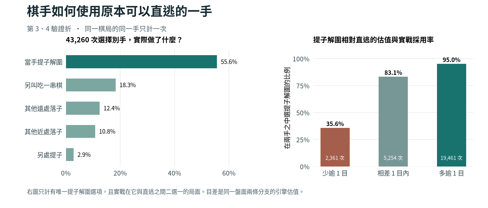

# 棋手有路可逃時，把這一手用在哪裡？

2026 年 11 月 18 日。以同一盤面比較「沿唯一氣點直逃」與「下另一手」，可以看見棋手對替代方案價值的反應。當盤上恰有另一手可以提子解圍時，在二選一的實戰中，提子比直逃的估值低逾一目，提子採用率為 35.6%，高逾一目時為 95.0%。按盤面估值差、原串大小和對局階段對齊後，實戰採用率的段位差為 2D 比 1D 高 1.18 個百分點、4D 比 3D 高 0.07 個百分點，兩個區間都涵蓋零。[選擇曲線](value_response.json)｜[相鄰段位的實戰比較](observed_grades.json)

## 從其他領域借來的方法

離散選擇研究從決策當下可用的選項估計偏好。本實驗先枚舉提子後能立即救回原串的合法著手，再記錄棋手選直逃、提子解圍或另走別處。足球的行動估值研究把一個動作放回當時的進攻與防守情境。這裡用固定的自我對弈 KataGo 比較同一段棋譜歷史分出的兩個子局面，估計「把這一手用在別處」值多少目。之後對手的實戰反應另外從棋譜讀取。引擎估值代表模型對未走分支的判斷，實戰只觀察到其中一條路。[McFadden，住宅區位的離散選擇模型](https://www.its.caltech.edu/~mshum/gradio/McFadden1978.pdf)｜[Decroos 等人，足球行動估值](https://arxiv.org/abs/1802.07127)｜[KataGo 原始與搜尋後的估值定義](https://github.com/lightvector/KataGo/blob/d91ea855110dae533f0aada947b2b7d78cc8a4e1/docs/Analysis_Engine.md#L269)

先前的實驗已測過脫先率、落子距離、一般強網失分，以及是否直逃。這次把「是否另有可行的救法」、「實際選了哪一手」、「同盤兩手的估值差」與「原串稍後是否被提」分別量出來。[過去的強網實驗](../../logs/nano4/ai_quality_pilot.py)｜[上一輪的事件定義](../ladder_rank_20261118/protocol.json)

## 改下別手之後發生什麼

115,445 局共 169,044 次機會符合直逃後全盤征子搜尋找不到吃法，其中 86,264 次走了別手。以下只用第 3、4 折的 57,650 局。84,746 次可直逃的機會中，43,260 次選別手，其中 42,668 次有完整紀錄可追蹤到對手第二手。每局每手只計一次。近處指直逃點周圍 7×7 內。各列按立即救串、提子、新叫吃、其他近／遠手依序判定。實戰虛手為零。[逐局與前次計數比對](extraction.json)｜[分項結果](results.json)

| 實戰選擇 | 次數及占比 | 有完整後續的次數 | 原串在對手兩手內被提 | 實戰相對直逃的估值差中位數 |
|---|---:|---:|---:|---:|
| 當手提子，原串立刻回到至少兩氣 | 24,058（55.6%） | 23,720 | 2.1% | +3.31 目 |
| 另將對方棋串叫吃 | 7,918（18.3%） | 7,811 | 50.9% | +3.60 目 |
| 其他遠處著手 | 5,379（12.4%） | 5,311 | 17.7% | +2.42 目 |
| 其他近處著手 | 4,669（10.8%） | 4,620 | 41.7% | +2.54 目 |
| 當手另提子，原串仍只有一氣 | 1,236（2.9%） | 1,206 | 37.1% | +3.16 目 |

全部別手的估值差中位數為 +3.17 目，72.5% 高於直逃逾一目，10.3% 低於直逃逾一目。在有完整後續的事件中，原串被提 7,784 次，其中 1,162 次，棋手在這段期間提掉的對方棋子至少有原串那麼多。另叫吃後原串常被提，同一類選擇的全盤估值仍常有利。兩手內的提子數只能描述短期交換，無法涵蓋先手及後續攻防利益。[實戰與引擎分支統計](results.json)

## 把被放棄的選項也算進來

驗證集有 28,756 次局面恰有一個其他著手能在提子後讓原串立即恢復至少兩氣。它在輪到棋手決策前即可從盤面找出。取所有選擇時，23,695 次採用這個提子解圍，3,381 次直逃，1,680 次另下第三手。另抽 169 個局面逐一試遍棋盤合法著點，所得選項與枚舉器完全相符。[選項枚舉與核對](offer_extraction.json)｜[依可提子數分組的採用率](offer_results.json)

| 引擎估計的提子解圍相對直逃價值 | 全部機會 | 實戰在兩手中擇一 | 二選一中採用提子 | 含第三手時採用提子 |
|---|---:|---:|---:|---:|
| 低逾一目 | 2,572 | 2,361 | 35.6% | 32.7% |
| 相差一目以內 | 5,586 | 5,254 | 83.1% | 78.2% |
| 高逾一目 | 20,598 | 19,461 | 95.0% | 89.8% |

高、低估值組的二選一採用率相差 59.4 個百分點，按棋手重抽的 95% 區間為 57.3 至 61.3 個百分點。完整估值比較使用相同歷史、規則、貼目、固定對稱及同一外部自我對弈網路 kata1-b18c384nbt-s9996604416-d4316597426。先前比較的 2,700 個別手局面另以每支 16 次搜尋複算，估值差的 Spearman 相關為 0.922，正負號有 93.7% 一致。本段為選擇與估值的關聯。棋手實際看到的選項與心理計算無從直接觀察。[兩條分支的核對](results.json)｜[包含放棄選項的估值結果](value_response.json)

## 棋力預測的瓶頸

主要模型只修正 SQ4 的 1D／2D 與 3D／4D 賠率，各組總機率固定，沿用原本最後的決策規則。第 1、2 折的 3,180 人、19,688 題用於擬合，第 3、4 折的 3,174 名不同棋手、19,639 題用於驗證。計分對 10 個等級與 3 種局數等權，同一棋手的重疊題目一起重抽。這些都是 R1 歷史上用過的內部折。[預先寫下的主實驗](protocol.json)｜[模型與結果](results.json)

| 加入的資料 | 相對 SQ4 得分差 | 棋手配對 95% 區間 |
|---|---:|---:|
| 實戰選了哪類別手及其出現機會 | −0.000826 | ［−0.002220，+0.000502］ |
| 再加入實戰與直逃的同盤估值差（主要模型） | −0.000886 | ［−0.002397，+0.000587］ |
| 再加入原串兩手內存亡與提子交換 | −0.001137 | ［−0.002667，+0.000358］ |
| 額外的條件選擇模型，只按面對同一對選項時各級如何回應相對價值 | −0.000149 | ［−0.000463，+0.000073］ |

SQ4 在這兩折為 0.795173，主要模型為 0.794286，125 題提高、146 題降低。主要模型比只知道行動類型的對照低 0.000061。原模型前兩級恰為 1D／2D 且真值在其中的 1,270 題，主要模型 AUC 增加 0.0043，區間為 ［−0.0102，+0.0186］。3D／4D 的 1,427 題下降 0.0106，區間為 ［−0.0217，+0.0010］。兩者都缺乏可重現的增益。[獨立逐題計分與區間](verification.json)

另做了一次直接棋譜比較，完全不用模型預測採用率。把驗證棋手按全盤估值差、原串大小及對局階段分為 30 種局面，用兩級棋手都有觀察的局面比實戰採用率。2D 減 1D 為 +1.18 個百分點，棋手重抽區間為 ［−0.66，+3.02］。4D 減 3D 為 +0.07 個百分點，區間為 ［−1.41，+1.59］。較小的段位差仍與這些資料相容。[實戰分層與各段原始比例](observed_grades.json)

同樣的取捨對段位能提供多少資訊，另以條件選擇模型檢查。對每個驗證局面固定盤面與兩手估值，只替換假設的段位，模型估計的提子採用率平均相差 0.28 個百分點（1D／2D）和 0.34 個百分點（3D／4D）。在留出棋手上以實戰行動計分，告知真實段位相對於兩級等權混合，每次二選一的平均對數分數增益分別為 −0.000037 bit（95% 區間 −0.000341 至 +0.000276）及 +0.000187 bit（−0.000080 至 +0.000457）。這是本次模型對這類選擇的解析度。五局題的此類二選一中位數只有 2 次，二十局題為 9 次。[資訊量及短題覆蓋](verification.json)

再以 2,543 名有二十局的棋手進行切半。各人的棋分成互不重疊的兩組十局，重分二十次。兩半相關的中位數，當手提子解圍的傾向為 0.113，實戰相對直逃的平均估值差為 0.073。即使單一步能用全盤估值解釋，少數幾局仍很難精準量出棋手之間的差別。[切半結果](results.json)

篩選下一類訊號時，可以先要求相鄰棋力在相近局面、面對相同可行選項時，呈現能在另一批對局重現的選擇差。只量出局面對所有棋手共有的吸引力，仍不足以從幾局棋推回段位。選項枚舉與條件選擇屬於探索性補充，使用相同歷史驗證折。正式題與排行榜未參與這批研究。[選項研究設計](menu_protocol.json)｜[相對估值研究設計](offered_value_protocol.json)
